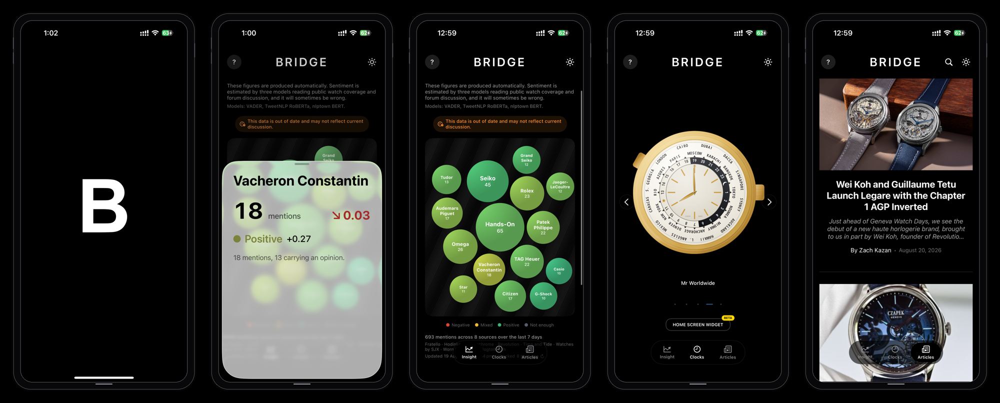

# Bridge

A companion app for watch enthusiasts. Bridge tracks what the watch world is talking
about, shows a set of live watch faces, and gathers the day's watch journalism into
one place.

Bridge is an independent passion project. It is not affiliated with any watch
manufacturer or publication. There are no accounts, no tracking, and no data
collection.

This repository is a showcase. It describes the project and shows what it looks like.
The source code is kept private.

## Two versions

- A native iOS app, built in SwiftUI, with a home screen widget.
- A free, installable web version, a Progressive Web App that runs in the browser and
  can be added to the home screen, with no App Store and no expiry.

Both show the same three tabs and read the same data, so they always agree.

## Insight

Insight is a live picture of watch brand sentiment. It counts how often brands and
models are mentioned across watch publications and enthusiast forums, then estimates
how positive or negative each mention is. Each bubble is sized by how much a brand is
being discussed and coloured by sentiment, running from red for negative through
orange for mixed to green for positive. A small arrow and percentage show how a
brand's sentiment has moved since the previous window.

The figures are produced away from the phone by a scheduled job that reads public
watch coverage, aggregates it to the brand level, and publishes a small summary file
that both versions read. No individual posts, authors, or usernames are ever stored
or shown. The brand list is not fixed: when a maker starts appearing across several
publications, Bridge picks it up on its own, so the chart reflects what is actually
being written about rather than a hand kept list.

## Clocks

Clocks is a carousel of original watch faces, each one drawn and animated in the app
rather than shown as a picture. They keep real time and include a world timer, a
perpetual calendar, a chronograph, and a flip clock, among others.

## Articles

Articles collects recent writing from a set of respected watch publications into a
single reading list, with search and a full reader.

## How the sentiment is estimated

Sentiment is not one model's guess. Three separate language models read each piece of
text and their results are combined: VADER, TweetNLP RoBERTa, and nlptown BERT.
Mention counts are exact, because they come from plain text matching. Sentiment is an
estimate and will sometimes be wrong, most often where enthusiast language is playful
or ironic. The sample is drawn from watch media, which tends to be positive overall,
so differences between brands carry more meaning than any single score.

## Built with

- SwiftUI and WidgetKit for the native iOS app
- Next.js, as a Progressive Web App, for the web version
- A Swift aggregation job with a three-model Python sentiment pipeline, run on a
  schedule rather than on the device
- A documented, self-assessed process aligned with the practices of ISO 9001,
  ISO/IEC 27001, and ISO/IEC 42001

## Privacy

Bridge has no account system and collects no personal information. The only things it
keeps are your chosen clock and display preferences, and those stay on your device.
